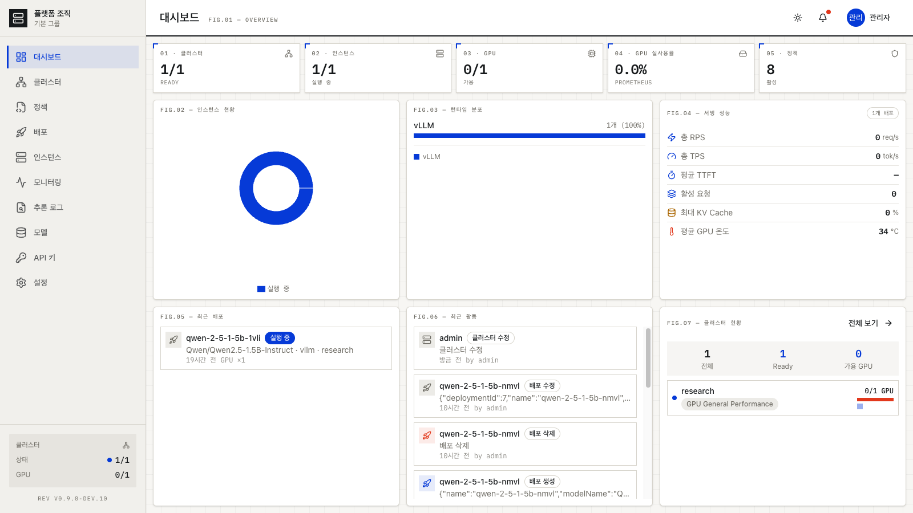
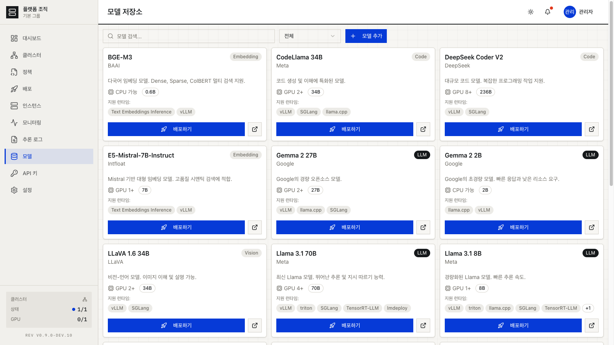
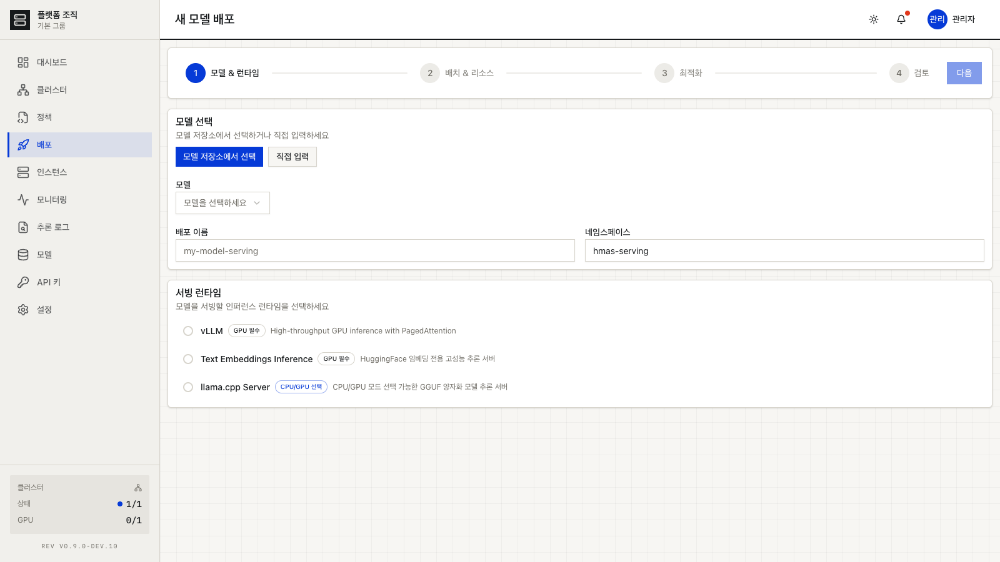
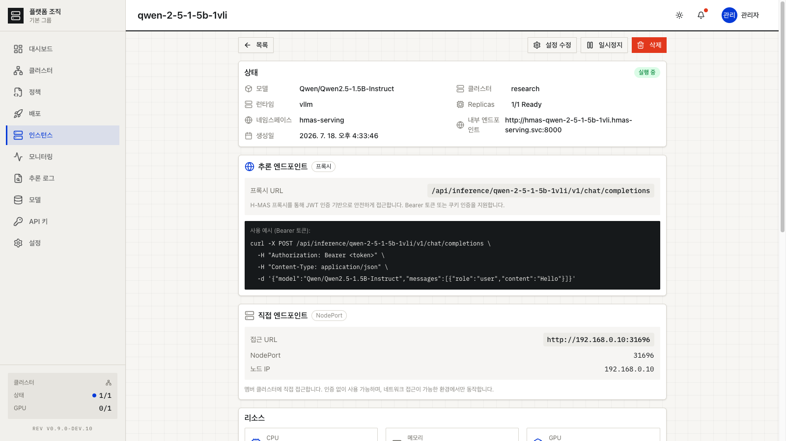
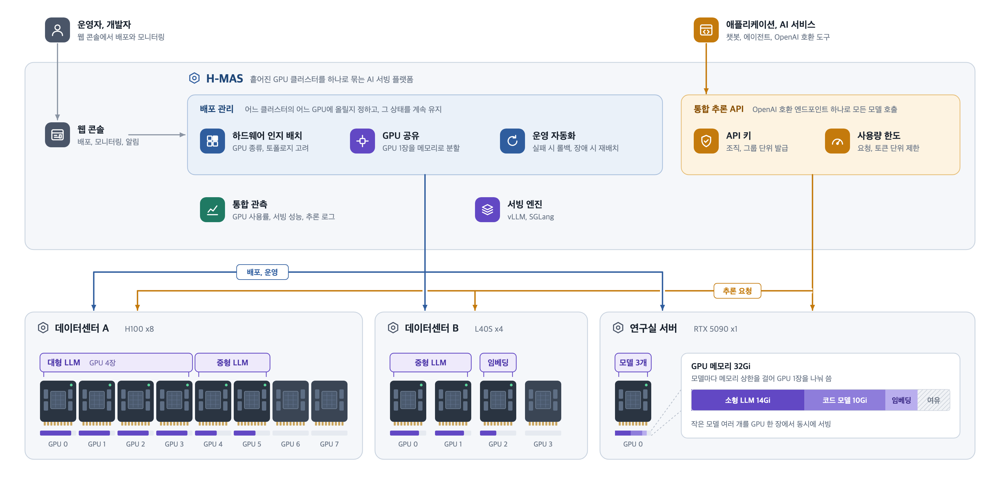
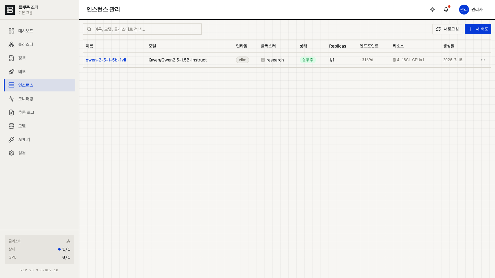
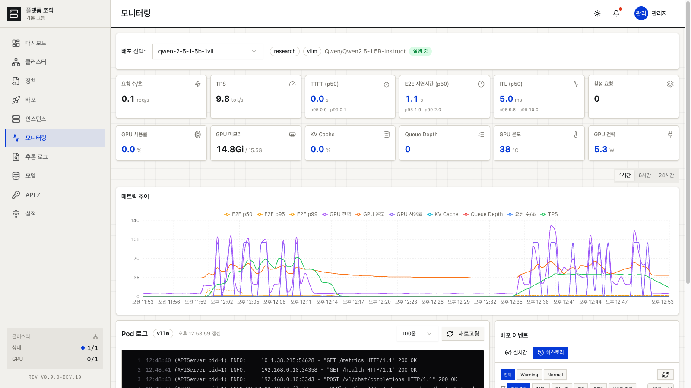

## 프로젝트 개요

H-MAS는 온프레미스 환경에 흩어진 GPU 서버들을 하나의 플랫폼에서 관리하고, AI 모델을 알맞은 하드웨어에 배치하는 **AI 서빙 플랫폼**입니다.

여러 GPU 클러스터를 하나의 컨트롤 플레인으로 묶고, 웹 콘솔에서 모델과 런타임을 고르면 GPU가 있는 클러스터에 배포됩니다. 배포된 모델은 OpenAI 호환 주소 하나로 호출하고, GPU 한 장을 메모리 단위로 나눠 작은 모델 여러 개를 함께 올릴 수도 있습니다. 장애가 나면 다른 클러스터로 재배치합니다.

2026년 9월에 v0.9를 냈고, 지금은 v0.10을 만들고 있습니다. 매주 진행 상황은 [개발 노트](/changelog/)에 남깁니다.

  
   
  <em>H-MAS 대시보드 — 클러스터, 인스턴스, GPU, 서빙 성능을 한 화면에서 확인 (v0.9 화면)</em>

---

## 해결하려는 문제

온프레미스에서 AI 모델을 서빙할 때 반복해서 부딪히는 문제들입니다.

| 문제 | 상세 |
|------|------|
| **GPU 활용률 저하** | GPU 서버가 여러 대 있어도 따로 운영되니 유휴 자원이 생기고, 작은 모델 하나가 GPU 한 장을 통째로 점유함 |
| **스케줄링 한계** | 기본 Kubernetes 스케줄러는 GPU 종류나 물리적 구조(PCIe, NUMA, 인터커넥트)를 모른 채 빈 곳에 배치함 |
| **관리 복잡성** | 서버마다 SSH 접속, 모델 배포 때마다 YAML 직접 작성, 장애 대응도 수동 |
| **연동 부담** | 배포마다 주소가 달라서, 모델을 바꿀 때마다 쓰는 쪽 설정도 바꿔야 함 |
| **장애 대응 공백** | 서버 장애 시 수동으로 다른 서버에 재배포해야 하고, 그동안 서비스가 멈춤 |

---

## 활용 시나리오

### 시나리오 1: GPU 서버 3~5대를 가진 AI 스타트업

> "vLLM으로 자체 LLM을 서빙하고 있는데, 서버가 3대로 늘면서 관리가 힘들어졌습니다."

**현재 상황**
- 사무실에 RTX 4090 서버 2대, 데이터센터에 L40S 서버 1대
- 서버마다 SSH로 접속해서 따로 관리
- 새 모델을 배포할 때마다 YAML 파일 직접 작성
- 서버 1대가 다운되면 수동으로 다른 서버에 재배포

**H-MAS를 쓰면**
- 3대의 서버를 하나의 플랫폼에 등록하고 웹 대시보드에서 함께 관리
- 웹 콘솔에서 모델 선택 → 런타임 선택 → 배포 (YAML 작성 불필요)
- 서버 장애 시 장애 복구 정책에 따라 다른 서버로 재배치
- 작은 모델 여러 개를 GPU 한 장에 메모리를 나눠 함께 서빙

### 시나리오 2: 이기종 GPU를 가진 대학 연구실 / 연구소

> "A100 4장, RTX 3090 8장이 있는데 큰 모델은 A100에서, 작은 모델은 3090에서 돌리고 싶습니다."

**현재 상황**
- A100 서버와 RTX 3090 서버가 섞여 있음
- 어떤 모델을 어떤 서버에 배포할지 매번 사람이 판단
- 연구원마다 서버를 점유해서 자원이 놀고 있음

**H-MAS를 쓰면**
- 두 종류의 서버를 각각 클러스터로 등록하면 H-MAS가 클러스터별 GPU 종류와 수량을 기록
- 큰 모델은 A100 클러스터를 지정해 여러 GPU에 나눠(Tensor Parallel) 배포하고, 작은 모델은 3090 클러스터에 배포
- 작은 모델은 GPU 메모리를 나눠 한 장에 여러 개를 올림
- 조직·그룹 단위로 클러스터와 정책을 나눠 연구실별로 따로 관리

### 시나리오 3: 자체 AI 서비스를 준비하는 중소기업 인프라팀

> "AI 모델 서빙을 시작하려는데, GPU 서버 관리부터 모델 배포까지 맡을 사람이 부족합니다."

**현재 상황**
- GPU 서버를 샀지만 AI 서빙 인프라를 구축해 본 경험이 없음
- Kubernetes는 운영 중이지만 GPU 워크로드는 처음
- 서빙 런타임 선택과 설정에 시행착오가 많음

**H-MAS를 쓰면**
- 기존 Kubernetes 클러스터에 H-MAS를 설치하고 웹 콘솔에서 바로 사용
- 모델별 지원 런타임과 GPU 요구사항을 배포 화면에서 확인하고, 사용 시나리오 프리셋으로 서빙 설정을 맞춤
- 사내 서비스나 오픈소스 채팅 UI는 OpenAI 호환 주소 하나와 API 키로 연결
- 장애 복구 정책과 알림으로 장애에 대비

---

## 기존 방식과의 비교

### 모델 배포

| 항목 | 기존 (kubectl + 수동) | H-MAS |
|------|---------------------|-------|
| 배포 방식 | YAML 직접 작성, kubectl apply | 웹 콘솔에서 모델·런타임·배치를 고른 뒤 배포 |
| 클러스터 선택 | 관리자가 판단 | 배치 전략(GPU가 있는 클러스터 자동 선택) 또는 클러스터 직접 선택 |
| GPU 할당 | GPU 수만 지정 가능 | GPU 수 지정, 또는 GPU 메모리를 나눠 한 장을 여러 모델이 공유 |
| 설정 변경 | YAML 수정 후 재적용 | 콘솔에서 수정하면 롤아웃으로 반영, 실패하면 자동 롤백 |
| 호출 주소 | 배포마다 다름 | OpenAI 호환 주소 하나, 요청의 모델 이름으로 배포를 찾아감 |

### 운영 관리

| 항목 | 기존 | H-MAS |
|------|------|-------|
| 클러스터 현황 파악 | 서버별 SSH 접속, kubectl 명령 | 조직 전체 클러스터를 한 화면에서 보는 모니터링 대시보드 |
| 장애 대응 | 알림 확인 → 수동 재배포 | 장애 복구 정책에 따라 다른 클러스터로 자동 재배치, 알림 센터로 통지 |
| 성능 확인 | 모니터링 도구 별도 구축 | 배포별 TPS·첫 토큰 지연·전체 지연·KV 캐시·GPU 사용률 차트 |
| 로그 확인 | 서버별 접속, kubectl logs | 웹에서 Pod 로그·이벤트·추론 요청 로그·감사 로그 조회 |
| 접근 관리 | 엔드포인트를 그대로 노출 | API 키 발급, 키별 요청·토큰 한도, 모든 추론은 H-MAS 인증을 거침 |

---

## 배포 워크플로우

H-MAS에서 모델을 배포하는 과정은 4단계입니다.

1. **모델 & 런타임** — 모델 저장소에서 모델을 고르고 서빙 런타임(vLLM 또는 SGLang)을 선택합니다. 배포 이름과 모델 정보는 자동으로 채워집니다.
2. **배치 & 리소스** — 배치 전략으로 자동 배치하거나 클러스터를 직접 고릅니다. GPU를 장 단위로 쓸지, GPU 메모리를 나눠 쓸지 정합니다.
3. **최적화** — 사용 시나리오 프리셋(챗봇, 긴 문서 처리, RAG 등)으로 서빙 엔진 설정을 한 번에 맞추고, 필요하면 개별 값을 조정합니다.
4. **검토** — 설정을 확인하고 배포를 시작합니다. 배포가 끝나면 인스턴스 상세에서 상태와 호출 주소를 확인합니다.

<table>
  <tr>
    <td></td>
    <td></td>
    <td></td>
  </tr>
  <tr>
    <td align="center"><b>모델 저장소</b></td>
    <td align="center"><b>배포 마법사</b></td>
    <td align="center"><b>배포된 인스턴스 상세</b></td>
  </tr>
</table>

---

## 핵심 기능

### 1. 멀티 클러스터 통합 관리

물리적으로 흩어진 GPU 클러스터를 하나의 컨트롤 플레인에 등록하고 함께 관리합니다.

- kubeconfig로 클러스터를 등록하면 컨트롤 플레인이 직접 연결 (같은 네트워크 안의 클러스터)
- 클러스터별 GPU 종류·수량을 기록하고, 이를 기준으로 GPU 서빙 대상 클러스터를 판단
- 클러스터별 노드 상태, GPU 사용량, CPU·메모리·디스크·네트워크 실사용률 확인
- 클러스터를 조직에 배정하고, 등록·해제 권한을 조직 관리자에게 위임할 수 있음
- 클러스터 하나만 있어도 같은 방식으로 쓰고, 나중에 클러스터를 추가해 넓힐 수 있음
- NAT·방화벽 뒤의 클러스터를 클러스터 쪽에서 먼저 연결하는 방식(에이전트)은 준비 중

### 2. 웹 콘솔 기반 모델 배포

웹 콘솔에서 모델 선택부터 배포, 이후 변경까지 처리합니다.

- 4단계 배포 마법사 (모델·런타임 → 배치·리소스 → 최적화 → 검토)
- vLLM, SGLang 런타임 지원
- 사용 시나리오 프리셋으로 서빙 엔진 설정을 한 번에 적용
- 도구 호출(tool calling)을 지원하는 모델은 런타임에 맞는 처리를 자동으로 켬 (현재 Qwen 계열)
- 배포 후 설정 수정·일시정지·재개·롤백, 저장 공간(PVC) 확장
- 복잡한 YAML 작성 불필요

### 3. 하드웨어 인지 배치와 GPU 공유

처음에는 클러스터를 고성능(HP)/범용(GP)으로 미리 나눠 모델 크기별로 보내는 구조였지만, v0.10에서 이 분류를 걷어냈습니다. 지금은 각 클러스터에 실제로 어떤 GPU가 있는지를 기준으로 배치합니다.

- **GPU 인벤토리 기반 배치**: 클러스터별로 기록된 GPU 종류·수량을 보고 배치 대상을 정함
- **하드웨어 인지 스케줄러**: GPU 클러스터에는 하드웨어 인지 스케줄러를 쓰고, QoS 클래스로 전용 CPU 바인딩과 워크로드 간 간섭을 제어
- **멀티 GPU 배포**: 큰 모델은 여러 GPU에 나눠(Tensor Parallel) 배포
- **GPU 공유 (VRAM 분할)**: GPU 메모리를 나눠 한 장에 여러 모델을 올림. GPU 메모리 격리 구성 요소가 설치된 클러스터에서는 메모리 상한이 강제됨. 공유가 가능한 클러스터에서만 배포 화면에 분할 입력이 나타남
- **진행 중**: 모델이 요구하는 자원과 GPU 토폴로지(NVLink/PCIe/NUMA)를 보고 클러스터와 GPU를 자동으로 고르는 배치는 v0.11에서 다시 설계

### 4. 장애 복구와 운영 자동화

- 클러스터 장애 시 장애 복구 정책(대기 시간, 기존 Pod 유예 시간)에 따라 다른 클러스터로 재배치
- 설정 변경은 롤아웃으로 반영하고, 새 버전이 뜨지 못하면 이전 설정으로 자동 롤백
- 컨트롤 플레인과 클러스터의 상태를 주기적으로 맞추고, 남은 리소스를 정리
- 모델 다운로드 시간을 고려한 기동 대기 시간을 관리자 콘솔에서 조정 (5~120분)

### 5. 모델 저장소

- 내장 모델 저장소에서 모델 등록·수정·삭제, 서빙 정보(GPU 요구사항, 지원 런타임) 관리
- 모델을 등록할 때 HuggingFace 정보를 읽어 메타데이터를 자동으로 채움
- 카테고리별 분류 (LLM, Code, Embedding 등)
- 시작용 모델 5종 기본 제공 (Qwen3 0.6B/1.7B/4B/8B, BGE-M3)
- 외부 모델 레지스트리(MLflow 등) 연동은 예정

### 6. 모델 로딩

- 배포마다 모델 캐시 볼륨(PVC)을 두어 재시작·롤아웃 때 모델을 다시 내려받지 않음
- 다음 단계로 HuggingFace 미러 설정, 같은 모델을 여러 배포가 공유하는 캐시 볼륨, S3 호환 저장소에서 직접 로드를 차례로 검토
- 분산 캐시는 소규모 온프레미스 환경에 운영 부담이 커서 보류

### 7. 통합 추론 API와 접근 제어

- 모든 배포를 OpenAI 호환 주소 하나로 호출하고, 요청의 모델 이름으로 배포를 찾아감. 호출 가능한 모델 목록도 같은 주소에서 조회
- 배포에 직접 접근하는 경로를 막아, 모든 추론 요청이 H-MAS 인증을 거침
- API 키 발급·폐기, 키별 분당 요청 수(RPM)·토큰 수(TPM) 한도, 실시간 사용량
- API 키 화면에서 Open WebUI 등 도구별 연결 설정과 curl 예시 제공
- 오픈소스 채팅 UI를 기본 설정 그대로 연결해 도구 호출까지 동작하는 것을 확인

### 8. 모니터링, 로그, 알림

- 조직 전체 클러스터를 카드로 보여주는 모니터링 대시보드, 클러스터 상세로 이동
- 배포별 요청 수·TPS·첫 토큰 지연(TTFT)·전체 지연(p50/p95/p99)·KV 캐시·GPU 사용률·온도·전력 차트
- Pod 로그, 배포 이벤트 이력, 추론 요청 로그(사용자·API 키·지연·토큰 단위), 감사 로그
- 배포 실패나 정리 작업 실패 같은 운영 이벤트를 알림 센터로 모음
- GPU를 나눠 쓰는 배포는 GPU 메트릭을 배포 단위로 나눌 수 없어, GPU 장치 단위 값을 대신 보여줌

### 9. 조직과 권한

- 조직·그룹 단위로 사용자, 클러스터, 배포, 정책을 나눔
- 역할 기반 권한(RBAC)과 조직 관리자 위임
- 배치·장애 복구 정책은 조직이 기본 템플릿을 복사해 따로 소유하고 수정
- 시스템 관리 작업은 별도 관리자 콘솔로 분리하고, 들어갈 때 승격 세션을 요구

### 10. 성능 기준값 측정 *(진행 중)*

- 배포를 골라 실행하면 표준 부하로 응답 지연·처리량 기준값을 측정해 기록
- 믿기 어려운 측정 결과는 기준값에서 자동으로 빠짐
- 서버 쪽 기능은 들어갔고, 실행 화면은 작업 중

---

## 아키텍처

운영자는 웹 콘솔로 배포를 관리하고, 애플리케이션은 통합 추론 API로 모델을 호출합니다. H-MAS는 그 사이에서 배포 관리, 추론 경로, 관측을 맡고, 실제 모델은 각 GPU 클러스터에서 vLLM·SGLang으로 돌아갑니다.

  
   
  <em>H-MAS 아키텍처 — 흩어진 GPU 클러스터를 하나로 묶는 AI 서빙 플랫폼 (2026년 11월 기준)</em>

| 구성 | 역할 |
|------|------|
| **배포 관리** | 어느 클러스터의 어느 GPU에 올릴지 정하고, 배포 상태를 계속 맞춤 (하드웨어 인지 배치, GPU 공유, 운영 자동화) |
| **통합 추론 API** | OpenAI 호환 주소 하나로 모든 모델 호출, API 키와 사용량 한도 |
| **통합 관측** | GPU 사용률, 서빙 성능, 추론 로그 |
| **서빙 엔진** | vLLM, SGLang. H-MAS는 추론 엔진을 대체하지 않고 그 위에서 동작 |
| **GPU 클러스터** | 데이터센터, 연구실 등 위치와 GPU 종류가 다른 클러스터. 컨트롤 플레인에는 GPU가 필요 없음 |

---

## 성능 측정

이 문서의 이전 버전에는 HP/GP 클러스터 구조를 전제로 한 **예상** 성능 수치(처리량 1.5배 등)가 있었습니다. 그 구조를 걷어내면서 예상치도 뺐고, 지금은 실제 환경에서 기준값을 재는 쪽으로 방향을 바꿨습니다.

- 배포별 성능 기준값 측정 기능의 서버 쪽 구현을 마쳤습니다 (v0.10).
- 실제 클러스터의 첫 측정에서 1.7B 모델 배포의 처리량은 동시 요청 4개에서 초당 약 370토큰으로 포화됐습니다.
- 기본 Kubernetes 대비 하드웨어 구성별 성능 비교 리포트는 v1.0 기준 중 하나로 두고 준비하고 있습니다.

측정 결과는 [개발 노트](/changelog/)에 계속 공개합니다.

---

## 서빙 런타임

H-MAS는 GPU 전용 플랫폼이며 CPU 추론은 지원하지 않습니다. 런타임은 실제로 비교·측정해 본 뒤 넣고, 겹치는 것은 정리했습니다.

| 런타임 | 특징 | 주요 용도 | 지원 상태 |
|-------|------|----------|----------|
| **vLLM** | PagedAttention, Continuous Batching, Tensor Parallel | LLM 서빙, 임베딩 서빙 | 지원 |
| **SGLang** | RadixAttention, 구조화된 출력 | 에이전트·구조화 출력 위주 서빙 | 지원 (v0.10) |
| **TensorRT-LLM** | NVIDIA GPU 전용 최적화 | 최고 성능이 필요한 경우 | 검토 예정 |

- 예전에 지원하던 임베딩 전용 런타임(TEI)과 llama.cpp는 v0.10에서 뺐습니다. 임베딩은 vLLM으로, 양자화 모델은 vLLM의 AWQ·GPTQ·FP8 지원으로 대신합니다.
- SGLang은 NVIDIA 드라이버 580 이상이 필요합니다.
- 모델별 지원 런타임은 배포 화면에서 자동으로 걸러서 보여줍니다.

---

## 화면 구성

2026년 11월에 v0.10 개발 버전으로 찍은 데모 영상(2분 15초)입니다. 모델 배포와 GPU 메모리 분할, 통합 추론 주소로 오픈소스 채팅 UI 연결, 모니터링과 추론 로그까지 이어서 보여줍니다.



> 아래 캡처는 v0.9 기준이라 영상과 조금 다릅니다. 이후 클러스터 유형(HP/GP) 표시가 사라졌고, 배포 화면의 런타임은 vLLM·SGLang으로 바뀌었으며, 조직 전체 모니터링 대시보드가 추가됐습니다.

### 대시보드

  
   
  <em>대시보드 — 클러스터·인스턴스·GPU 현황, 런타임 분포, 서빙 성능, 최근 활동</em>

- **통계 카드**: 클러스터 수, 실행 중인 인스턴스, GPU 가용량, GPU 사용률, 활성 정책
- **인스턴스 현황**과 **런타임별 분포**
- **서빙 성능**: 요청 수, TPS, 첫 토큰 지연, KV 캐시, GPU 온도
- **클러스터 현황**과 **최근 활동**

### 클러스터 관리

- 클러스터별 상태, GPU 종류·사용량, 노드 수, 인스턴스 수
- 노드별 CPU·메모리·디스크·네트워크 실사용률과 이벤트
- 클러스터 등록·해제, 조직 배정 (온보딩 정책에 따라 조직 관리자에게 위임 가능)
- GPU/NUMA 토폴로지 화면은 있지만, 아직 예시 데이터로 그림

### 모델 배포

  
   
  <em>모델 배포 — 모델 & 런타임, 배치 & 리소스, 최적화, 검토 4단계 마법사</em>

- 모델·런타임 선택 시 배포 이름과 모델 정보 자동 입력
- 배치 전략 또는 클러스터 직접 선택, GPU 장 단위 또는 메모리 분할
- 사용 시나리오 프리셋과 고급 설정 (도구 호출 처리 포함)

### 인스턴스 관리

  
   
  <em>인스턴스 목록 — 상태, 런타임, 클러스터별 필터링과 검색</em>

- 상태, 런타임, 클러스터별 필터링과 검색
- 일시정지·재개, Replicas 조정, 설정 수정, 롤백, 삭제

  
   
  <em>인스턴스 상세 — 상태, 모델 정보, 서빙 설정, 추론 엔드포인트</em>

### 모니터링과 로그

  
   
  <em>배포별 메트릭과 Pod 로그 — 지금은 '로그' 메뉴로 옮겨졌고, '모니터링' 메뉴는 조직 전체 대시보드가 됨</em>

- 배포별 TPS, 지연시간(p50/p95/p99), KV 캐시, GPU 사용률·메모리·온도·전력 차트
- Pod 로그와 배포 이벤트 이력
- 추론 요청 로그 — 요청별 사용자, API 키, 첫 토큰 지연, 토큰 수
- 감사 로그 — 배포 생성·수정·삭제 등 플랫폼 활동 이력

---

## 시스템 요구사항

**공통**: Linux (Ubuntu 22.04+ / RHEL 8.6+), AMD64, 커널 5.4+

### Management Cluster (컨트롤 플레인)

| 항목 | 최소 사양 | 권장 사양 |
|------|---------|---------|
| Kubernetes | 1.26+ | 1.29+ |
| 노드 | 1대 | 3대 (HA 구성) |
| CPU | 4 코어 | 8 코어 |
| 메모리 | 8 GB | 16 GB |
| 디스크 | 50 GB SSD | 100 GB SSD |

Management Cluster에는 GPU가 필요하지 않습니다. 기존에 운영 중인 Kubernetes 클러스터를 사용할 수 있습니다.

### Member Cluster (모델 실행)

| 항목 | 요구사항 |
|------|---------|
| Kubernetes | 1.26+ |
| GPU | NVIDIA GPU 1장 이상 |
| GPU Driver | NVIDIA Driver 525+ (535+ 권장, SGLang은 580+) |
| Container Runtime | containerd 1.6+, NVIDIA Container Toolkit 1.14+ |
| 네트워크 | Management Cluster와 통신 가능 |

### 지원 GPU

| 카테고리 | GPU 모델 |
|---------|---------|
| 데이터센터 | A100, H100, H200, L40S, L4, T4, A10 |
| 워크스테이션 | RTX 4090, RTX 5090, RTX A6000 |
| DGX (x86 기반) | DGX A100, DGX H100 |

x86(AMD64) 서버에 장착된 CUDA 지원 NVIDIA GPU라면 등록해서 쓸 수 있습니다. DGX Spark, GH200·GB200처럼 ARM(Grace) CPU를 쓰는 장비는 지원하지 않습니다. 다만 실제로 검증한 환경은 아직 제 클러스터뿐입니다.

---

## 로드맵

| 시점 | 버전 | 내용 | 상태 |
|------|------|------|------|
| 2026년 4월 | **v0.4** | 멀티 클러스터 관리, 기본 서빙, 대시보드 | 완료 |
| 2026년 7월 | **v0.7** | 통합 추론 API, 실시간 모니터링, 인증·인가(RBAC·API 키), 멀티테넌시 | 완료 |
| 2026년 9월 | **v0.9** | 관리자 콘솔과 승격 세션, 조직별 정책, 배포 직접 접근 차단, 알림 센터, 노드 실사용률 | 완료 |
| 2026년 10월~ | **v0.10** | GPU 공유, 통합 추론 주소, 조직 전체 모니터링, HP/GP 분류 제거, SGLang 도입, 성능 기준값 측정 | 진행 중 |
| 이후 매월 | **v0.11 …** | 모델 요구량 기반 자동 배치 재설계, 클러스터 에이전트(Pull 연결), 모델 캐시, 운영 도구 | 예정 |
| 날짜 없음 | **v1.0** | 아래 기준을 모두 채우면 정식 버전 | 예정 |

v0.9부터는 단계 이름(DP, FP 등) 없이 v0.10, v0.11 … 순으로 매월 릴리스를 계획합니다. 처음에 v0.9 목표로 잡았던 토폴로지 인식 고성능 서빙과 분산 캐시는 계획을 바꿔, 각각 자동 배치 재설계와 모델 캐시 재구성으로 이어갑니다.

**v1.0 기준**
- 파일럿 환경에서 1개월 이상 무장애 운영
- 설치부터 첫 모델 배포까지 30분 이내
- 조직·그룹 기반 리소스 격리
- 기본 Kubernetes 대비 하드웨어 구성별 성능 비교 리포트
- 명령 한 줄로 설치·업그레이드
- 운영 매뉴얼과 트러블슈팅 가이드

### 버전별 제공 기능

| 기능 | v0.4 | v0.7 | v0.9 | v0.10 (개발 중) |
|------|:----:|:----:|:----:|:---------------:|
| 멀티 클러스터 관리 | v | v | v | v |
| 웹 콘솔 기반 모델 배포 | v | v | v | v |
| 통합 대시보드 | v | v | v | v |
| 자동 장애 복구 | v | v | v | v |
| 로그·이벤트·감사 로그 | v | v | v | v |
| 통합 추론 API (OpenAI 호환) | — | v | v | v (주소 하나로 통합) |
| 실시간 메트릭 (GPU, TPS, 지연) | — | v | v | v |
| 추론 요청 로그 / 사용량 한도 | — | v | v | v |
| RBAC·API 키·멀티테넌시 | — | v | v | v |
| QoS 기반 스케줄링 | — | v | v | v |
| 관리자 콘솔·조직별 정책 | — | — | v | v |
| 알림 센터·노드 실사용률 | — | — | v | v |
| GPU 공유 (VRAM 분할) | — | — | — | v |
| 조직 전체 모니터링 대시보드 | — | — | — | v |
| SGLang 런타임 | — | — | — | v |
| 성능 기준값 측정 | — | — | — | 서버 쪽만 |
| 모델 요구량·토폴로지 기반 자동 배치 | — | — | — | v0.11 예정 |
| 클러스터 에이전트 (Pull 연결) | — | — | — | 예정 |
| 외부 인증 연동 (OAuth/OIDC) | — | — | — | 예정 |

### 릴리스 히스토리

| 버전 | 날짜 | 요약 | 릴리스 노트 |
|------|------|------|------------|
| v0.9.0 | 2026-09-26 | 관리자 콘솔과 승격 세션, 조직별 정책, 배포 직접 접근 차단, 알림 센터, 노드 실사용률 | [릴리스 노트](/posts/2026/09/h-mas-v0.9.0-release/) |
| v0.7.0 | 2026-07-05 | 통합 추론 API(OpenAI 호환), 실시간 모니터링, RBAC·API 키, 멀티테넌시 | [릴리스 노트](/posts/2026/07/h-mas-v0.7.0-release/) |
| v0.4.0 | 2026-04-05 | 멀티 클러스터 관리, 웹 콘솔, JWT 인증, 원커맨드 설치 | [릴리스 노트](/posts/2026/04/h-mas-v0.4.0-release/) |

---

## 자주 묻는 질문 (FAQ)

**Q. 기존에 운영 중인 Kubernetes 클러스터에 설치할 수 있나요?**
네. H-MAS는 기존 Kubernetes 클러스터 위에 설치됩니다. Management Cluster 하나에 H-MAS를 설치하고, GPU 서버 클러스터를 Member로 등록하면 됩니다.

**Q. 설치에 얼마나 걸리나요?**
컨트롤 플레인은 설치 스크립트나 Helm Chart로 설치합니다. GPU 클러스터를 등록한 뒤 스케줄러와 모니터링 구성 요소는 아직 가이드를 따라 직접 설치해야 해서, 환경에 따라 시간이 달라집니다. 설치부터 첫 모델 배포까지 30분 이내로 줄이는 것이 v1.0 목표입니다.

**Q. GPU가 1장뿐인 서버도 등록할 수 있나요?**
네. GPU 1장 서버도 클러스터로 등록해 쓸 수 있습니다. GPU 메모리를 나눠 작은 모델 여러 개를 함께 올리거나, 다른 클러스터의 장애 복구 대상으로 둘 수 있습니다.

**Q. 클러스터가 1개뿐인데도 사용할 수 있나요?**
네. H-MAS를 설치한 클러스터 하나를 Member로도 등록하면, 웹 콘솔 배포·대시보드·로그 등 모든 기능을 똑같이 씁니다. 나중에 클러스터를 추가해도 같은 방식으로 넓어집니다.

**Q. NVIDIA GPU가 아닌 AMD GPU도 지원하나요?**
현재는 NVIDIA GPU만 지원합니다.

**Q. ARM 서버(DGX Spark, Grace 기반 장비)에서도 쓸 수 있나요?**
아니요. 현재는 x86(AMD64) 서버만 지원합니다. DGX Spark, GH200·GB200처럼 ARM CPU를 쓰는 장비는 지원하지 않습니다.

**Q. CPU만 있는 서버에서도 모델을 서빙할 수 있나요?**
아니요. H-MAS는 GPU 전용으로 방향을 정했습니다. CPU 추론용 런타임은 v0.10에서 뺐습니다.

**Q. 클라우드 GPU 인스턴스도 연결할 수 있나요?**
Kubernetes가 설치되어 있고 컨트롤 플레인에서 접근할 수 있는 환경이라면 온프레미스·클라우드 상관없이 등록할 수 있습니다. NAT·방화벽 뒤에 있어서 컨트롤 플레인이 직접 닿지 않는 클러스터를 연결하는 방식은 준비 중입니다.

**Q. 기존 vLLM으로 서빙 중인 모델이 있는데, H-MAS로 옮길 수 있나요?**
네. H-MAS는 vLLM을 그대로 서빙 엔진으로 씁니다. 같은 모델과 설정을 배포 화면에 넣으면 같은 환경으로 배포되고, 호출하는 쪽은 주소만 H-MAS 통합 추론 주소로 바꾸면 됩니다. Ollama 등 다른 런타임은 지원하지 않습니다.

**Q. 보안과 인증은 어떻게 되나요?**
로그인 인증(JWT)과 RBAC, 조직·그룹 단위 리소스 분리, 추론용 API 키와 사용량 한도를 제공합니다. 배포에 직접 접근하는 경로는 막혀 있어서 모든 추론은 H-MAS 인증을 거칩니다. 시스템 관리 작업은 승격 세션이 필요한 별도 콘솔에서만 할 수 있고, 주요 작업은 감사 로그에 남습니다. 외부 인증(OAuth/OIDC) 연동은 예정입니다.

**Q. 학습(Training)도 지원하나요?**
아니요. H-MAS는 AI 모델 서빙(Inference)에만 집중합니다.

**Q. 지금 안 되는 것은 무엇인가요?**
[H-MAS 소개 페이지](/hmas/)의 "지금 되는 것, 아직 안 되는 것"에 정리해 두었습니다.

---

## 요약

| 항목 | 내용 |
|------|------|
| **프로젝트명** | H-MAS (Hardware-aware Multi-Cluster AI Serving Platform) |
| **분류** | 온프레미스 AI 서빙 플랫폼 |
| **핵심 가치** | 흩어진 GPU 클러스터 통합 관리, GPU 종류를 고려한 배치와 GPU 공유, OpenAI 호환 단일 추론 주소 |
| **대상** | GPU 인프라를 가진 스타트업, 연구소, 대학 연구실, 중소기업 |
| **현재 버전** | v0.9 (2026년 9월 출시), v0.10 개발 중 |
| **연락처** | [문의하기](/contact/) |
