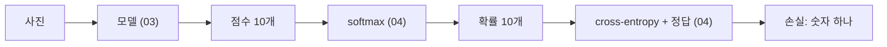

> 이 글은 `notebooks/04_loss.ipynb`에서 한 일을 처음부터 다시 설명합니다.
> [03](/posts/2026/10/nn-from-scratch-03-model/)에서 모델이 낸 점수 `(64, 10)`이 여기로 들어옵니다.

## 이 노트북에서 한 일, 한 줄로

**"모델의 점수를 확률로 바꾸는 `softmax`와, 그 확률이 정답에서 얼마나 벗어났는지를 숫자 하나로 재는 `cross_entropy`를 만들었다."**

03까지는 "사진 → 점수"만 있었습니다. 이 점수가 **맞았는지 틀렸는지** 판단하는 장치가 없었어요. 이 노트북이 그 "채점기"를 만듭니다. 채점 결과(손실)가 있어야 다음 단계(역전파)에서 "어디를 고칠지"를 계산할 수 있습니다.



---

## 1. 점수는 왜 바로 못 쓰나? → 확률로 바꿔야 한다

모델이 낸 점수는 `x @ W + b`의 결과라 **아무 실수**나 나옵니다. 음수도, 100도 나올 수 있죠. "이 사진이 7일 가능성"처럼 읽으려면 **확률**이어야 하고, 확률에는 두 조건이 있습니다.

| 조건 | 뜻 | 점수는? |
|---|---|---|
| ① 0 이상 | "−30% 확률"은 없다 | ❌ 음수 가능 |
| ② 합이 1 | 모든 경우를 더하면 100% | ❌ 합이 아무 값 |

주사위를 생각하면 됩니다. 1~6이 나올 확률은 각각 1/6이고, 전부 0 이상이며, 더하면 1이죠.

---

## 2. softmax: 두 조건을 만족시키는 가장 단순한 방법

점수 3개 `z = [2, 1, -1]`로 봅니다.

**① 전부 양수로: `exp`**

```python
e = np.exp(z)      # [7.39, 2.72, 0.37]
```

`exp`(지수 함수)는 어떤 수를 넣어도 **항상 양수**를 돌려줍니다. −1도 0.37이 됐죠. 게다가 큰 점수는 더 크게, 작은 점수는 더 작게 **벌려 줍니다.**

**② 합이 1로: 합으로 나누기**

```python
p = e / e.sum()    # [0.705, 0.259, 0.035]
p.sum()            # 1.0
```

각 값을 전체 합으로 나누면 합은 반드시 1입니다. 100점, 50점, 50점을 200으로 나누면 0.5, 0.25, 0.25인 것과 같아요.

이 두 줄이 **softmax**입니다. 이름은 거창한데 "지수 취하고, 합으로 나누기"가 전부예요.

### 이름의 뜻

`z`에서 2와 1은 **1점 차이**인데 `p`에서는 0.705와 0.259로 **거의 3배** 차이가 났습니다. `exp`가 차이를 벌리기 때문입니다. 그래서 soft**max**예요. 가장 큰 값을 뽑되(max), 딱 하나만 고르는 게 아니라 확률로 부드럽게(soft) 고릅니다.

---

## 3. 그대로 쓰면 터진다: `exp` 오버플로우

```python
z = np.array([1000.0, 0.0, 0.0])
np.exp(z)          # [inf  1.  1.]   RuntimeWarning: overflow
```

`exp(1000)`은 10의 434제곱쯤 됩니다. float64가 담을 수 있는 최댓값은 10의 308제곱이라 넘쳐 버렸어요. 02의 `uint8` 오버플로우는 0으로 돌아갔는데, float는 **`inf`(무한대)**가 됩니다.

여기서 끝이 아닙니다. 이걸로 확률을 만들면

```
p = [inf/inf, 1/inf, 1/inf] = [nan, 0, 0]
```

`inf / inf`는 `nan`(Not a Number)이고, `nan`은 **어떤 계산을 해도 `nan`**입니다. 손실이 `nan`, 기울기가 `nan`, 가중치 전체가 `nan`으로 오염됩니다. 학습 중에 손실이 갑자기 `nan`으로 찍히는 건 가장 흔한 사고 중 하나이고, 원인의 절반이 이 `exp`입니다. 점수가 1000까지 가는 일은 학습 초반에 학습률이 조금만 커도 금방 생깁니다.

### 해결: 최댓값을 빼고 `exp`

핵심 성질: **점수 전체에서 같은 값을 빼도 softmax 결과는 변하지 않는다.**

```
 e^(z - c)        e^z · e^(-c)       e^z
──────────── = ──────────────── = ────────
 Σ e^(z - c)    e^(-c) · Σ e^z     Σ e^z
```

`e^(-c)`가 분자와 분모에 똑같이 생겨서 약분됩니다. 그러니 `c = max(z)`를 빼면 **가장 큰 점수가 0**이 되고, `exp(0) = 1`이니 절대 넘치지 않습니다. 나머지는 음수라 `exp`가 0~1 사이에 들어가고요.

```python
z = np.array([1000.0, 0.0, 0.0])
e = np.exp(z - z.max())    # z - 1000 = [0, -1000, -1000] → exp = [1, 0, 0]
e / e.sum()                # [1. 0. 0.]
```

`[1, 0, 0]`은 이상한 결과가 아닙니다. 1000점 대 0점이면 "무조건 0번"이 맞죠. `e^(-1000)`은 너무 작아서 0으로 반올림되는데(underflow), 위로 넘치는 것과 달리 **무해**합니다.

| 같은 입력 `[1000, 0, 0]` | 결과 |
|---|---|
| 최댓값 안 빼면 | `[nan, 0, 0]` (계산이 깨짐) |
| 최댓값 빼면 | `[1, 0, 0]` (올바른 답) |

수학적으로는 같은 식인데 컴퓨터의 float에서는 **계산 순서가 결과를 좌우**합니다.

---

## 4. 배치로 확장: `axis`

실제 점수는 `(64, 10)`입니다. 사진 64장 각각에 대해 **행마다 따로** softmax를 해야 해요.

```python
def softmax(z):
    e = np.exp(z - z.max(axis=1, keepdims=True))
    return e / e.sum(axis=1, keepdims=True)
```

### `axis=1`이 뭔가

`axis`는 "**어느 방향으로 뭉개는가**"입니다. 2행 3열 예로:

```
        열0  열1  열2
행0  [  2,   1,  -1 ]
행1  [  0,   5,   0 ]

z.max(axis=0) = [2, 5, 0]   ← 세로로 뭉갬. 열마다 하나. shape (3,)
z.max(axis=1) = [2, 5]      ← 가로로 뭉갬. 행마다 하나. shape (2,)
```

외우는 법: **`axis=k`는 shape에서 k번째 숫자를 지운다.** `(64, 10)`에서 `axis=1`이면 10이 지워져 `(64,)`, 즉 사진마다 하나. "사진 한 장의 점수 10개"를 다루고 싶으니 10이 지워져야 하고, 그래서 `axis=1`입니다.

"axis=1은 열 아닌가?"라는 혼란이 있었는데, 둘 다 맞습니다. **1번 축(열 방향)을 따라 훑으면 열이 사라지고 행마다 하나가 남습니다.** `axis`가 가리키는 건 **없어지는 축**이지 남는 축이 아니에요.

### `keepdims=True`가 뭔가

`z.max(axis=1)`은 `(64,)`인데, `keepdims=True`를 주면 `(64, 1)`로 **지운 자리를 크기 1로 남겨 둡니다.** 그래야 `z - (64, 1)`에서 브로드캐스팅이 **행 방향으로** 복사됩니다. `(64,)`로 빼면 `(64, 10) - (64,)`가 돼서 뒤쪽 축 10과 64가 안 맞아 에러가 납니다.

### 만들면서 겪은 실수: `axis`가 섞임

처음엔 `max`는 `axis=0`, `sum`은 `axis=1`로 썼습니다. 그런데 **행 합은 전부 1로 나왔어요.** 마지막 줄이 "행을 행의 합으로 나눈다"라서 앞에서 무슨 값을 만들었든 행 합은 무조건 1이 되거든요. 즉 "행 합이 1"이라는 검사는 마지막 줄만 보고 첫 줄의 `axis`는 전혀 못 봅니다.

그래서 **정답을 아는 입력**으로 다시 확인했습니다.

```python
softmax(np.array([[1000.0, 0.0, 0.0], [0.0, 0.0, 0.0]]))[0]
# axis=0 (틀림): [0.33, 0.33, 0.33]  ← 1000점 대 0점인데 셋이 같다?
# axis=1 (맞음): [1, 0, 0]
```

`axis=0`은 **열마다 다른 값**(세로 방향 최댓값)을 빼니까 한 행 안에서도 원소마다 빼는 값이 달라져서 약분이 안 되고 확률이 바뀝니다. 교훈: **항상 참인 성질로 검사하면 테스트는 통과하지만 아무것도 확인하지 못한다.** 03의 "`np.zeros`를 넣으면 버그가 숨는다"와 같은 교훈입니다.

---

## 5. 손실: `-log(정답 확률)`

이제 확률이 생겼으니 "얼마나 틀렸나"를 잽니다. 아이디어는 한 줄입니다.

```
손실 = -log(모델이 정답에 준 확률)
```

숫자를 넣어 보면 이 식의 모양이 보입니다.

```
정답 확률 p     -log(p)
  1.0           0        ← 완벽. 벌점 없음
  0.9           0.105
  0.5           0.693
  0.1           2.303
  0.01          4.605    ← 확신하고 틀림. 벌점 큼
  0.0           inf      ← 폭발
```

### 왜 `-log`인가? 세 가지 이유

**① 원하는 모양:** 맞으면 0, 틀릴수록 커지고, **확신하고 틀리면 폭발.** "틀렸다"보다 "확신하면서 틀렸다"를 훨씬 세게 벌줍니다.

**② `1 - p`는 왜 안 되나:** `1 - p`도 맞으면 0, 틀리면 커집니다. 하지만 `p = 0.01`과 `p = 0.001`은 10배 차이인데 `1 - p`는 0.99와 0.999로 거의 구별을 못 합니다. 최댓값이 1이라 그 이상 벌을 못 줘요. `-log`는 4.6과 6.9로 계속 벌립니다. 더 중요한 건 **기울기**인데, softmax 뒤에 `1 - p`를 붙이면 확신하고 틀린 경우(`p ≈ 0`)에 기울기가 거의 0이 돼서 **가장 많이 고쳐야 할 때 학습 신호가 가장 약해집니다.** `-log`는 기울기가 `p - 1 ≈ -1`로 항상 또렷하게 남습니다.

**③ 어디서 온 식인가:** 학습의 목표를 가장 자연스럽게 말하면 "모델이 **정답에 준 확률**이 모든 사진에서 최대한 높아지게 하자"입니다. 6만 장 전체로는 "정답 확률들의 **곱**을 최대화"인데, 0~1 사이 수를 6만 번 곱하면 0이 됩니다. 그래서 `log`를 씌워 **곱을 합으로** 바꿉니다(`log(a·b) = log a + log b`). 그리고 "최대화"보다 "최소화"가 관례라 **마이너스**를 붙입니다.

```
곱을 최대화  →  log 씌워 합으로  →  부호 뒤집어 최소화
Π p_i        →  Σ log p_i        →  Σ -log p_i
```

### "log는 보상, -log는 벌점"이 아니다

`log p`와 `-log p`는 **같은 곡선을 위아래로 뒤집은 것**입니다. 마이너스가 하는 일은 "최대화 문제를 최소화 문제로 바꾸기" 하나뿐이에요. 진짜 특성은 log 곡선의 **비대칭**에 있습니다.

| 정답 확률이 | log가 하는 일 |
|---|---|
| 1에 가까울 때 | 손실이 0에 붙어 평평해짐. "더 잘 맞추기"에 큰 보상 없음 |
| 0에 가까울 때 | 손실이 끝없이 커짐. "확신하고 틀리기"를 한계 없이 벌함 |

그러니 "정답에 보상"이라기보다 **"정답은 벌을 면제받고, 확신한 오답은 가차 없이 벌받는다"**입니다. 손실은 0 아래로 못 내려가니 "보상"은 "벌점 0"이 최대예요. 이 비대칭 덕분에 이미 잘 맞추는 사진은 그만 신경 쓰고, **틀린 사진에 학습 신호를 집중**하게 됩니다.

### 이름

"cross-entropy"는 정보 이론 용어입니다. `-log p`는 "확률 `p`인 사건이 일어났을 때의 **놀라움**"이에요. 손실은 "정답이 나왔을 때 모델이 얼마나 놀랐는가"의 평균입니다. 좋은 모델은 정답에 안 놀라야 하고요. 지금 단계에서는 **"정답 확률의 -log 평균"**이라고 불러도 뜻은 같습니다.

---

## 6. 정답 자리의 확률만 뽑기: 팬시 인덱싱

실제로는 `p`가 `(64, 10)`이고 정답 `y`가 `(64,)`입니다. 사진 i의 **정답 자리** `p[i, y[i]]`를 64개 전부 뽑아야 합니다.

```python
p = np.array([[0.7, 0.2, 0.1],
              [0.1, 0.1, 0.8],
              [0.3, 0.6, 0.1]])
y = np.array([0, 2, 0])

picked = p[np.arange(3), y]    # [0.7 0.8 0.3]
```

### `p[np.arange(len(p)), y]`를 조각내서 보면

이 한 줄이 처음엔 안 읽혔습니다. 여섯 조각으로 쪼개면:

```
            열0    열1    열2
행0  p[0]  [0.7,   0.2,   0.1]
행1  p[1]  [0.1,   0.1,   0.8]
행2  p[2]  [0.3,   0.6,   0.1]
```

1. `p[0, 0]` → 0.7, `p[1, 2]` → 0.8, `p[2, 0]` → 0.3. 값 하나씩 꺼내는 건 익숙함. 원하는 게 이 셋.
2. 행 번호만 모으면 `[0, 1, 2]`, 열 번호만 모으면 `[0, 2, 0]`.
3. numpy는 **행 자리에 목록, 열 자리에 목록**을 넣으면 같은 위치끼리 짝지어 한꺼번에 꺼냄: `p[[0,1,2], [0,2,0]]` → `[0.7, 0.8, 0.3]`.
4. 열 목록 `[0, 2, 0]`은 **`y`가 이미 갖고 있음.** 정답 숫자가 곧 찾아갈 열 번호.
5. 행 목록 `[0, 1, 2]`는 `np.arange(3)`, 즉 `np.arange(len(p))`로 만듦.
6. 합치면 `p[np.arange(len(p)), y]`.

```
p[np.arange(len(p)), y]
  └──────┬───────┘  └┬┘
     [0, 1, 2]     [0, 2, 0]
      행 목록        열 목록
```

반복문으로 풀면 `for i in range(len(p)): picked.append(p[i, y[i]])`와 같습니다. `np.arange(len(p))`는 이 반복문의 `i`를 **한꺼번에 배열로** 만든 거예요.

주의: `p[rows, y]`(좌표 짝짓기)와 `p[rows][y]`(행을 두 번 인덱싱)는 다릅니다. 쉼표 하나 차이로 결과 shape이 달라집니다.

---

## 7. `cross_entropy` 함수

5절과 6절을 합치면 세 줄짜리 절차입니다.

```
1. 사진마다 정답 자리의 확률을 뽑는다        ← 6절
2. 각각에 -log를 씌운다                       ← 5절
3. 평균낸다                                   ← 숫자 하나로
```

6절의 `picked = [0.7, 0.8, 0.3]`으로 끝까지 손 계산하면:

```
-log(0.7) = 0.357    ← 꽤 잘 맞춤, 벌점 작음
-log(0.8) = 0.223    ← 잘 맞춤
-log(0.3) = 1.204    ← 못 맞춤 (1번에 0.6을 줌), 벌점 큼

평균 = (0.357 + 0.223 + 1.204) / 3 = 0.595
```

**이 0.595가 cross-entropy 손실입니다.** "이 배치에서 모델이 평균적으로 얼마나 틀렸나"를 숫자 하나로 만든 것.

```python
def cross_entropy(p, y):
    picked = np.clip(p[np.arange(len(p)), y], 1e-12, None)   # 1. 정답 자리 확률
    return -np.log(picked).mean()                             # 2. -log, 3. 평균

cross_entropy(p, y)    # 0.5946  ← 손 계산과 일치
```

### 왜 평균이고 합이 아닌가

합으로 하면 배치가 64장일 때와 32장일 때 손실이 2배 차이 납니다. 모델은 똑같은데 배치 크기 때문에 숫자가 달라지면 "학습이 잘 되고 있나"를 비교할 수 없어요. 평균이면 "사진 한 장당 벌점"이 되어 배치 크기와 무관합니다. 02에서 마지막 배치가 32장이었던 걸 기억하세요.

### `np.clip`은 뭔가

5절 표의 마지막 줄, `-log(0) = inf`를 막는 장치입니다. softmax의 underflow로 정답 자리가 정확히 `0.0`이 되는 순간이 오면 손실이 `inf`가 되고 학습이 깨집니다. `np.clip(x, 1e-12, None)`은 "1e-12보다 작으면 1e-12로 올려라"이고(상한 `None`은 위는 안 막음), `-log(1e-12) = 27.6`이라는 **유한한 값**이 나옵니다. `log` **앞**에 있어야 합니다. 뒤에 있으면 이미 `inf`가 된 다음이라 소용없어요.

---

## 8. 정답을 아는 입력으로 확인

softmax 때 배운 교훈대로, 답을 아는 입력 두 개로 확인합니다.

```python
# 완벽한 예측: 손실 0
cross_entropy(np.array([[1.0, 0.0, 0.0]]), np.array([0]))    # -0.0

# 아무것도 모름 (10개 다 0.1): 손실은?
cross_entropy(np.full((1, 10), 0.1), np.array([3]))          # 2.3026
```

`-0.0`은 `-1 × 0.0`이라 부호만 붙은 0이고, `0.0 == -0.0`은 `True`입니다. 버그 아닙니다.

**2.3026은 꼭 기억해 두세요.** `-log(0.1) = log(10)`입니다. 랜덤 가중치로 학습을 시작하면 모델이 10개 숫자에 거의 똑같은 확률을 주기 때문에, **첫 손실이 거의 정확히 이 값**으로 찍힙니다. 이 값보다 크게 시작하거나 여기서 안 내려가면 어딘가 버그라는 뜻이에요. 학습 단계에서 가장 먼저 보는 "정상 신호"입니다.

---

## 9. 이 노트북에서 배운 것

| 용어 | 뜻 |
|---|---|
| 확률의 두 조건 | 0 이상, 합이 1 |
| softmax | `exp` 취하고 합으로 나누기. 점수 → 확률 |
| `exp` 오버플로우 | `exp(1000) = inf` → `inf/inf = nan` → 전부 오염 |
| 최댓값 빼기 | 같은 값을 빼도 softmax는 불변. 가장 큰 점수를 0으로 만들어 넘침 방지 |
| underflow | 너무 작아서 0으로 반올림. 위로 넘치는 것과 달리 무해 |
| `axis=k` | shape에서 k번째 숫자를 지운다 |
| `keepdims=True` | 지운 자리를 크기 1로 남겨 브로드캐스팅이 행 방향으로 되게 |
| cross-entropy | 정답 확률의 `-log` 평균 |
| `-log`를 쓰는 이유 | 확신한 오답을 무한히 벌하고 정답은 0에서 멈추는 비대칭. "곱을 최대화"를 합으로 바꾼 것 |
| 팬시 인덱싱 (2차원) | `p[행목록, 열목록]`, 같은 자리끼리 짝지어 좌표로 |
| `np.clip` | 하한선 막기. `log(0)` 방지 |
| 2.3026 | `log(10)`. 랜덤 모델의 첫 손실 |

---

## 스스로 확인해 보기

1. `softmax([3, 3, 3])`의 결과는?
2. `softmax([5, 1])`과 `softmax([105, 101])`은 같을까요, 다를까요?
3. `z.sum(axis=1, keepdims=True)`에서 `z`가 `(64, 10)`이면 결과 shape은?
4. 정답 확률이 0.5에서 0.05로 떨어지면 손실은 얼마나 커지나요? (`-log(0.5) = 0.693`)
5. `p = [[0.2, 0.5, 0.3]]`, `y = [1]`일 때 `p[np.arange(1), y]`는?
6. 배치 64장에서 전부 정답에 확률 1을 줬다면 손실은? 전부 정답에 확률 0.1을 줬다면?
7. `np.clip`을 `log` 뒤로 옮기면 왜 소용없나요?

<details markdown="1">
<summary>답</summary>

1. `[1/3, 1/3, 1/3]`. 점수가 같으면 확률도 같다.
2. 같다. 둘 다 "차이가 4". 같은 값(100)을 뺀 것뿐이라 softmax 불변.
3. `(64, 1)`. `keepdims` 없으면 `(64,)`.
4. `-log(0.05) = 3.0`. 0.693에서 3.0으로, 약 2.3 커짐 (10배 틀릴 때마다 2.3씩).
5. `[0.5]`. 행 0, 열 1.
6. 0과 `log(10) = 2.3026`. 평균이라 사진 수와 무관.
7. `-log(0)`이 이미 `inf`가 된 뒤라서. `inf`를 clip해도 상한이 `None`이면 그대로 `inf`.

</details>

---

**이전 글:** [03. 숫자 784개를 받아서 "0~9 중 뭘까" 점수 10개로 바꾸기](/posts/2026/10/nn-from-scratch-03-model/)

**다음 글:** [05. 손실에서 출발해 거꾸로 올라가며 "`W`를 어느 방향으로 고쳐야 손실이 줄어드나"를 계산하기. 연쇄 법칙과 수치 기울기 검사](/posts/2026/10/nn-from-scratch-05-backward/)

**시리즈 소개:** [00. 시작하며 (전체 목차)](/posts/2026/10/nn-from-scratch-00-intro/)
